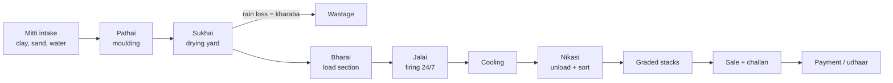
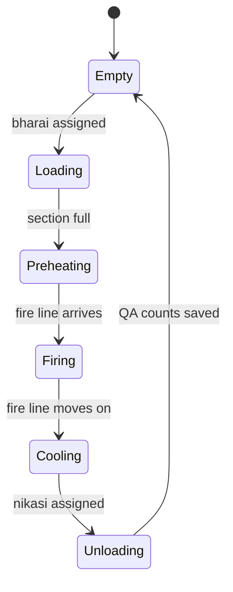
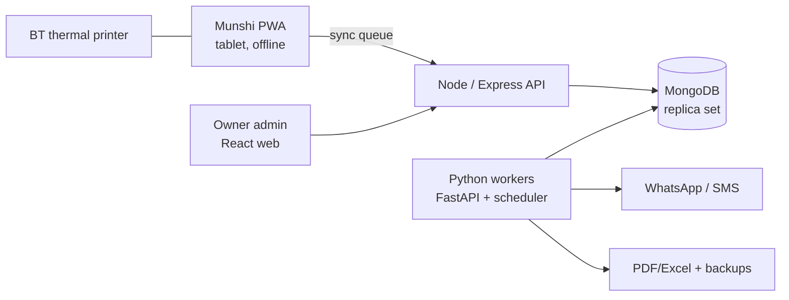

# Brick Kiln ERP — Consolidated Design (Sadiqabad Zig-Zag Kiln)

2026-09-20 · @Someone

## 1. How the two papers were merged

The consolidated design keeps Paper B's operational depth (chamber state machine, GRN/landed cost, thermal printer receipts, per-chamber COGS) and Paper A's legal and commercial guardrails (peshgi cap, contracts, minimum wage, multi-tenant MERN). Where they conflict, the decision below applies everywhere else in this doc.

Paper A = the earlier Claude research report. Paper B = the research you pasted from the other tool.

| Topic | Paper A | Paper B | Consolidated decision |
| --- | --- | --- | --- |
| Database | MongoDB (MERN) | PostgreSQL, fully relational | MongoDB replica set with multi-document transactions, Decimal128 money, JSON-schema validation. Matches your MERN skills; ledger integrity comes from append-only design, not from SQL. |
| Advances | Capped at Rs 50,000, receipted | "Significant" advances, no cap mentioned | Hard cap of Rs 50,000 per worker (Punjab Brick Kilns Act 2016, s.4); override only by owner, with reason, logged. |
| Term | Peshgi | "Peshi" | Peshgi (پیشگی). Also use kharchi/kharcha for weekly allowance. |
| Debt recovery | Deduction from pay, no rule | Auto-withhold 25% of daily gross | Configurable % per contract (default 25%), shown on every receipt, with a floor so weekly cash never drops below a set kharchi minimum. |
| Sync conflicts | Append-only ledger | CRDT or timestamp resolution | Append-only events with client UUIDs (idempotent). No CRDT needed: ledger rows are never edited, only reversed. |
| Caching | Not specified | Redis | Skip Redis for one kiln. Add only when multi-tenant load demands it. |
| Kiln structure | Sections, configurable | 26–32 chambers, 156–192 ft | Configurable section count per kiln; default 28. Values from Paper B are starting templates, not constants. |
| Quality rating | Composite 0–100 score | Rule-based diagnosis per team | Both: rules decide which team a defect is blamed on; the score aggregates it. Independent QA sampling added (see section 8). |
| Awwal yield | "A-grade up 90%" (CCA) | 90%+ Awwal share | Target 85–90%; the system learns the real baseline from your own unloading data. |
| Brick prices | South Punjab lower than Lahore | Awwal Rs 16,000–19,000 | Versioned price list per grade, edited by owner. No hard-coded prices. |
| Tax | Not covered | FBR withholding, NTN vs cash buyers | Adopted. Customer type drives tax lines; rates live in a config table your accountant maintains. |
| Compliance | Child labour, contracts, min. wage, EOBI/PESSI | EPD smog dashboard, fan logs | Both combined into one Compliance module. |
| Soil & coal quality | Not covered | Silica/alumina %, coal ash/volatile matter | Adopted as optional lab fields on each GRN, used to correlate fuel batches with yield. |
| Hardware | QR parchi | Bluetooth ESC/POS Urdu printer | Both: printed Urdu slip with a QR code the worker can scan to verify. |
| Mapping | Leaflet site map | Kiln "command center" schematic | Both: SVG kiln-section board for operations + Leaflet map for yards, clay pits, delivery sites. |
| Carbon credits | Not covered | Verra/Gold Standard revenue | Kept as a Phase 3 option only; eligibility and buyers are uncertain for a single new kiln. |

What both papers missed and this design adds: the jamadar (labour contractor) as an entity, family-level peshgi tracking, drying-yard rain loss (kharaba) as its own stock event, and mixed-batch attribution when several moulders' bricks share one section.

## 2. Business baseline (all values configurable)

The software is a digital twin of one continuous process: clay becomes green bricks, green bricks move through kiln sections as the fire advances, and fired bricks become graded stacks and cash. Every number below seeds a settings screen; the owner overwrites it with real figures in season one.



The fire moves roughly 1.5–2 sections per day; preheating, firing and cooling zones travel with it.

| Parameter | Seed value | Source |
| --- | --- | --- |
| Kiln sections | 28 (range 26–32) | Paper B |
| Firing temperature | 900–1,100 °C | Paper B |
| ID fan | 12–15 hp | Paper B |
| Coal per brick | \~70 g zig-zag vs 90–100 g FCBTK | Paper A (CCAC) |
| Specific energy consumption | \~1.06–1.2 MJ/kg fired brick | Paper B, widened |
| Output | 25,000–60,000 bricks/day | Paper A |
| Season | Oct–Jun; monsoon stop; possible smog closures | Both |
| Soil ageing | 3 months minimum | Paper B |
| Target soil mix | Silica \~62%, alumina \~23%, iron oxide >3% | Paper B |
| Labour share of cost | 36–40% of COGS (small/medium) | Paper A |
| Net margin benchmark | 15% small, 21% medium, 29% large | Paper A |

**Grades and price list.** Four sellable grades plus waste: Awwal (A), Doem (B), Soem, Khangar (over-burnt, for soling/foundations) and Rori (broken). Paper B's Punjab ranges are Awwal Rs 16,000–19,000, Doem Rs 11,000–14,000, Khangar Rs 8,000–11,000 per 1,000. Sadiqabad and nearby Sindh markets usually sell below Lahore rates, so set your own price list before the first sale.

**Diesel and power.** The ID fan must never stop during firing. Load-shedding means a generator; track diesel litres and generator hours as a firing cost (Paper B).

## 3. Compliance rules built into the software

Compliance is enforced as validation, not as a report: the app refuses or flags the action at the moment of entry. These rules protect the owner from FIRs, fines and kiln sealing during inspections.

| Rule | Law / authority | System behaviour |
| --- | --- | --- |
| No worker under 14; CNIC or Form-B required | Punjab Prohibition of Child Labour at Brick Kilns Act 2016 | Worker cannot be saved without CNIC/Form-B and a date of birth showing age 14+ (recommend 15+). Duplicate CNIC blocked. |
| Written contract for every worker | Same Act | Contract PDF (Urdu + English) auto-generated at onboarding; worker cannot receive pay until signed/thumb-printed copy is uploaded. |
| Peshgi ≤ Rs 50,000, with register and payback schedule | Same Act, s.4 | Advance entry blocked above cap; owner override needs reason and second approval. Statutory peshgi register printable anytime. |
| No coercive debt; transparent balances | Bonded Labour System (Abolition) Act 1992 and Punjab amendments | Every ledger entry printed on a slip; worker can check balance by QR. Season-end settlement statement per worker. |
| Piece rate ≥ notified minimum | Punjab Minimum Wages notification (2024: Rs 2,738 per 1,000 for pathera) | Rate plan below the notified minimum shows a red warning on the owner dashboard. Minimum rates stored as versioned table. |
| EOBI and PESSI registration | EOBI Act; Punjab Employees Social Security | Fields per worker; monthly contribution report; dashboard count of unregistered workers. |
| Zig-zag only; smog-season rules | Punjab EPD | Compliance log of fan running hours, chimney maintenance, EPD NOC expiry reminder; exportable "Smog Compliance Report". |
| Sales tax / withholding | FBR | Customer type (registered/NTN vs individual) drives tax lines on invoices; monthly tax summary export. |

The 2025 minimum-wage notification revised rates again; enter the current figure from the Punjab Labour Department before season start rather than relying on the 2024 value.

## 4. Labour categories and user roles

Ten worker types cover everything you described; each maps to one pay basis and one module. Workers are grouped into teams, teams into families where relevant, and every team can link to a jamadar.

| Category | Local term | Work | Pay basis | Module |
| --- | --- | --- | --- | --- |
| Manager | Munshi | Daily data entry, cash, labour relations | Monthly salary | Munshi app |
| Supervisor | Mistri / fire-master | Stacking pattern, fire control, QA sampling | Monthly or shift | QA, Firing |
| Moulders | Pathera / Pathair | Mould green bricks | Per 1,000 moulded | Moulding |
| Inbound transport | Bharai, rehra wala | Carry dry bricks, stack in zig-zag pattern | Per 1,000 loaded | Loading |
| Firemen | Jalai | Feed coal 24/7 in shifts, watch fan | Per shift / daily | Firing |
| Sealers | Keri wala | Seal gaps, ash covering | Daily or monthly | Firing |
| Outbound transport | Nikasi | Unload, sort, build counted stacks | Per 1,000 unloaded | Unloading |
| Repairers | Mistri / beldar | Walls, flues, chimney, fan | Daily wage or job | Maintenance |
| Drivers | Trolley / truck driver | Deliveries, coal haul | Monthly or per trip | Sales, Procurement |
| Contractor | Jamadar | Recruits teams, may hold advances | Commission per 1,000 | Labour |

**Software user roles** (people who log in, separate from workers):

| Role | Can do | Cannot do |
| --- | --- | --- |
| Owner | Everything, approvals, overrides, all reports | — |
| Accountant | Cash book, invoices, supplier bills, settlements | Change rate plans, delete anything |
| Munshi | Attendance, production counts, kharchi, advances up to a limit, GRN, challans | Approve large advances, edit past days |
| Mistri | QA sampling, firing logs, repair orders | Money entries |
| Viewer / partner | Read dashboards and reports | Any entry |

Workers themselves get no login in Phase 1; they see their balance on the printed slip and by scanning its QR code.

## 5. Workflows

Nine workflows cover the kiln; each one writes stock movements and, where people are paid, ledger entries in the same transaction. The kiln section itself is a state machine that every production workflow moves forward.



The munshi taps "Advance fire" once a day; the app moves the fire line one or two sections and updates every section's state.

### 5.1 Procurement (coal, soil, diesel, repair materials)

1. Truck arrives; munshi creates a Goods Receipt Note: supplier, vehicle no., weight (weighbridge slip photo), rate.
2. Optional lab fields: coal calorific value, ash %, volatile matter; soil silica/alumina/iron.
3. Freight and unloading labour added → landed cost per tonne calculated automatically.
4. Supplier bill becomes a payable; payments reduce it.
5. Coal issued to firing daily → consumption log per section and per shift.

### 5.2 Moulding and drying

1. Evening walk of the drying yard: munshi picks a pathera team from the photo grid, enters the count, taps the yard plot on the map.
2. System creates a moulding batch, credits the team ledger at its rate, prints a slip.
3. Rain or damage: munshi records kharaba against the batch; green stock drops. Paper B's weather risk becomes data.
4. Once dry, batch status changes to "ready to load".

### 5.3 Loading (bharai)

1. Munshi opens the kiln board, taps an empty section, assigns a bharai team.
2. Enters counts per source batch (one section can hold several moulders' batches).
3. Green stock falls, section stock rises, bharai team is credited per 1,000.

### 5.4 Firing (jalai, 24/7)

1. Shift handover: incoming fireman is checked in; outgoing writes a one-line note.
2. Every few hours: coal fed (kg), temperature reading, fan running yes/no, generator hours if grid down.
3. Daily "Advance fire" moves sections through the state machine.
4. Fan stop longer than a set minutes triggers a WhatsApp alert to the owner.

### 5.5 Unloading, sorting and QA (nikasi)

1. Cooled section alerts the munshi; nikasi team assigned.
2. Counts entered per grade: Awwal, Doem, Soem, Khangar, broken.
3. Mistri records an independent sample (e.g. 200 bricks) to check the nikasi team's sorting.
4. Finished stock rises by grade and stack location; nikasi team credited.
5. Section cost closes: fuel + labour + overhead share ÷ saleable bricks = cost per brick for that section.

### 5.6 Sales and delivery

1. Order: customer, grade, quantity, rate (from price list, editable within limits).
2. Delivery challan printed: vehicle, driver, destination pin on map.
3. Invoice with tax lines by customer type; cash or udhaar.
4. Receipts reduce the receivable; aging buckets 0–30, 31–60, 61–90, 90+ days.

### 5.7 Labour pay cycle

1. Daily: piece-work and shift credits accumulate automatically from 5.2–5.5.
2. Weekly (e.g. Saturday): system proposes kharchi per worker = credits − peshgi deduction; munshi pays cash, slip printed.
3. Advances: request → cap check → approval if above munshi limit → cash → slip.
4. Season end: settlement (hisab) statement per worker and family; balance paid or carried with written consent.

### 5.8 Repairs and maintenance

1. Mistri or munshi raises a repair order: structure (wall, flue, chimney, fan, wicket), photo, urgency.
2. Repair labour and materials charged to the order; closed with an after-photo.
3. Preventive schedule for fan bearings, belts and chimney inspection.

### 5.9 Daily close (roznamcha)

1. Munshi counts cash in hand at day end.
2. System compares with opening cash + receipts − payments; any variance needs a reason.
3. Owner gets a WhatsApp summary: production, sales, cash, alerts.

## 6. Data model (MongoDB)

About thirty collections in seven domains, every document carrying `tenantId`, `kilnId`, `seasonId`, `createdBy`, `createdAt` and a client-generated `clientUuid` for offline sync. Paper B's relational tables map one-to-one onto these collections; Paper A's jamadar, family and compliance entities are added.

**Ledger principles (non-negotiable)**

- Money in `Decimal128`, never JS floats.
- Ledger entries are append-only; a mistake is fixed by a reversing entry that points to the original.
- Balances are computed from entries (and cached in a snapshot field), never typed in.
- Every money write runs in a MongoDB transaction together with its stock movement.
- `clientUuid` has a unique index, so a re-synced offline entry can never be posted twice.

| Domain | Collection | Key fields |
| --- | --- | --- |
| Setup | tenants | name, plan, ownerUserId |
| Setup | kilns | name, location (GeoJSON Point), sectionCount, fanHp, epdNocNo, epdNocExpiry |
| Setup | seasons | name (2026-27), start, end, closureWindows\[\] |
| Setup | kilnSections | index, capacity, state (Empty…Unloading), currentLoad, geometry (GeoJSON Polygon) |
| Setup | yards | type (drying, clay pit, coal, stack), geometry |
| Labour | workers | name, CNIC/Form-B, dob, photo, category, familyId, teamId, jamadarId, eobiNo, pessiNo, status |
| Labour | families | head worker, members\[\], combined peshgi limit |
| Labour | teams | category, leadWorkerId, memberIds\[\], splitRule (equal / by share) |
| Labour | jamadars | name, CNIC, commissionPer1000, teamIds\[\] |
| Labour | contracts | workerId, season, rateplanId, recoveryPct, kharchiFloor, signedDocUrl |
| Labour | ratePlans | category, basis (per1000 / shift / day / month), amount, effectiveFrom, notifiedMinimum |
| Labour | attendance | workerId, date, shift (day/night), inTime, outTime, handoverNote |
| Labour | ledgerEntries | partyType (worker/team/jamadar), partyId, type, debit, credit, sourceRef, reversesId, receiptNo |
| Production | mouldingBatches | teamId, date, count, yardId, kharaba\[\], status |
| Production | sectionLoads | sectionId, batchId, count, bharaiTeamId, date |
| Production | firingLogs | sectionId, shift, firemanIds\[\], coalKg, tempC, fanOn, genHours, time |
| Production | fireAdvances | date, fromSection, toSection, by |
| Production | unloadings | sectionId, nikasiTeamId, awwal, doem, soem, khangar, broken, stackIds\[\] |
| Production | qaSamples | sectionId, sampleSize, gradeCounts, defects (crack, chip, underburnt, overburnt), mistriId |
| Inventory | items | name, unit, type (raw, fuel, spare, green, fired-by-grade) |
| Inventory | stockMovements | itemId, qty, from, to, refType, refId, unitCost |
| Inventory | grns | supplierId, vehicleNo, qty, rate, freight, landedUnitCost, labFields{}, slipPhoto |
| Commercial | suppliers / customers | name, phone, NTN, type, creditLimit |
| Commercial | salesOrders / challans / invoices | customerId, lines\[grade, qty, rate\], taxLines\[\], vehicle, destination (GeoJSON) |
| Commercial | payments | direction (in/out), partyId, amount, mode (cash/bank/JazzCash), allocations\[\] |
| Finance | expenses | category, amount, payee, sectionId?, repairOrderId?, photo |
| Ops | repairOrders | structure, sectionId, assignedIds\[\], materials\[\], cost, before/after photos, status |
| System | users, auditLog, settings | role, kilnIds\[\]; actor, action, before, after, device; prices, tax rates, thresholds |

Section cost (COGS per section) is a derived view built from firingLogs, sectionLoads, unloadings, ledgerEntries and expenses; do not store it by hand.

## 7. Wage, advance and settlement engine

Pay is computed continuously from work entries, then settled weekly in cash and finally at season end. The engine merges Paper B's automatic recovery with Paper A's cap and transparency rules.

```latex
\text{Weekly kharchi} = \max\Big(\text{Gross credits} - r \cdot \text{Gross credits},\ \text{Kharchi floor}\Big),\quad \text{Recovery} = \text{Gross credits} - \text{Weekly kharchi}
```

Here r is the contract recovery rate (default 25%). If the floor applies, recovery shrinks for that week so the family always has living money.

**Worked example (one pathera family, one week)**

| Item | Value |
| --- | --- |
| Bricks moulded (6 days × 2,000) | 12,000 |
| Rate per 1,000 (2024 notified minimum) | Rs 2,738 |
| Gross credit | Rs 32,856 |
| Recovery at 25% | Rs 8,214 |
| Kharchi paid in cash | Rs 24,642 |
| Peshgi before / after | Rs 50,000 → Rs 41,786 |
| Weeks to clear at this pace | about 6 |

**Engine rules**

- Team work is split to members by the team's rule (equal, or by share such as 1.0 adult, 0.5 helper); the slip shows each member's part.
- Firemen and repairers are credited per shift or day from attendance; missing handover notes flag the shift for review, not the pay.
- Jamadar commission per 1,000 is posted automatically to the jamadar's own ledger, never taken from worker pay.
- A new advance runs three checks: worker cap, family cap, and munshi's approval limit.
- Season-end settlement lists every entry, total earned, total paid, peshgi outstanding; both sides sign or thumb-print; PDF stored.
- Any carried-over balance requires a new signed consent in the next season's contract; the system will not roll it silently.

## 8. Labour quality rating

Each team gets a 0–100 score per section and per season, built from traced defects rather than the munshi's opinion. Paper B's diagnostic rules decide who a defect belongs to; Paper A's composite turns it into a score.

**Traceability chain:** moulding batch (pathera) → section load (bharai) → firing shifts in that section's firing window (jalai) → unloading (nikasi) → QA sample (mistri).

**Two fixes to Paper B's design**

- Mixed sections: a section usually holds several moulders' batches. Defects are attributed in proportion to each batch's share of the section load, not all to one team.
- Conflict of interest: the nikasi team sorts its own output. The mistri's independent sample is the official grade mix; a large gap between nikasi counts and the sample lowers the nikasi score.

| Defect seen in QA | Blamed on | Why |
| --- | --- | --- |
| Cracks, warping, lime bursting, poor edges | Pathera (by batch share) | Moulding and pugging faults show before firing |
| Chips and corner damage, no firing fault | Bharai and nikasi (split) | Handling damage |
| Khangar share above target | Jalai shifts in that window | Over-feeding coal |
| Under-burnt (pale, weak) bricks | Jalai; bharai if stacking gaps logged | Low heat or poor airflow |
| Nikasi count ≠ QA sample | Nikasi | Sorting accuracy |

```latex
\text{Score} = 50\,Q + 20\,W + 20\,P + 10\,R
```

Q = quality (share of Awwal + Doem relative to kiln target), W = low wastage, P = output versus team-size norm, R = attendance and shift reliability; each factor scaled 0–1.

**How the score is used:** bonuses per 1,000, first choice of yard plots, rehiring priority and promotion to mistri. It is never used to cut the notified minimum rate. Teams see their score and the counts behind it on the weekly slip and can dispute within 7 days.

## 9. KPIs, reports and alerts

The owner dashboard is built on twelve KPIs; the three that move profit most are coal per 1,000 bricks, Awwal share, and cost per saleable brick.

```latex
\text{Net profit} = \sum_{g} Q_g P_g - \big(C_{coal} + C_{soil} + C_{labour} + C_{diesel} + C_{repair} + C_{overhead}\big)
```

Q is quantity sold per grade g and P its realised price; costs come from the ledger and expenses for the same period.

| KPI | Formula | Alert when |
| --- | --- | --- |
| Cost per saleable brick | Section cost ÷ (Awwal+Doem+Soem+Khangar) | Above set threshold |
| Coal per 1,000 fired | Coal kg ÷ fired bricks × 1,000 | 10% above 4-week average |
| Specific energy consumption | Coal kg × calorific value ÷ fired brick kg | Rising 3 weeks in a row |
| Awwal share | Awwal ÷ total unloaded | Below 85% target |
| Wastage | (Kharaba + broken) ÷ moulded | Above 10% |
| Moulding output | Bricks per team per day | Team 20% below norm |
| Fan uptime | Fan-on hours ÷ firing hours | Any stop over set minutes |
| Gross and net margin | From formula above | Net below 15% |
| Cash position | Cash + bank today | Below one week's payroll |
| Receivables aging | Udhaar by age bucket | Any customer over 90 days |
| Outstanding peshgi | Sum of worker balances | Worker near Rs 50,000; total not falling by mid-season |
| Compliance gaps | Missing contracts, EOBI, NOC days left | Any gap; NOC under 30 days |

| Report | Frequency | Delivered as |
| --- | --- | --- |
| Roznamcha (cash book) and production summary | Daily | WhatsApp text + PDF |
| Kharchi sheet, team output, quality scores | Weekly | PDF, printed slips |
| P&L, stock by grade, receivables, payables, fuel efficiency | Monthly | PDF + Excel |
| Trend review: margin, Awwal share, coal, prices | Quarterly | Dashboard + PDF |
| Season settlement, peshgi register, labour history | Season end | PDF per worker + summary |
| EPD smog compliance, EOBI/PESSI, FBR tax summary | Monthly / on demand | PDF + Excel |

**Long-term analytics (Phase 3):** coal price and brick demand forecasts from your own seasons plus market prices, cash-flow projection to time coal buying, and peshgi amortisation curves so no season ends with unrecoverable advances.

## 10. System architecture

Use your existing MERN stack for the product and Python for background work; it is simpler than Paper B's PostgreSQL + Redis + CRDT design and fully adequate for one to fifty kilns.



| Layer | Choice | Reason |
| --- | --- | --- |
| Field app | React PWA (Vite), installable on Android tablets | One codebase with admin; works offline |
| Local storage | IndexedDB via Dexie.js | Stores every entry instantly, survives restarts |
| Sync | Outbox queue of events with clientUuid; server returns confirmed ids; pull changes since last sync | Idempotent, no CRDT needed |
| API | Node + Express, Zod validation, JWT + refresh tokens | Your existing skill set |
| Database | MongoDB replica set (Atlas M10 or self-hosted), transactions on | Ledger + stock written together |
| Background | Python: FastAPI + APScheduler (or Celery), pandas, ReportLab/WeasyPrint | Reports, forecasts, alerts, backups |
| Messaging | WhatsApp Cloud API; SMS fallback | Owner summaries and alerts |
| Maps | Leaflet + GeoJSON for sections, yards, clay pits, delivery pins | Your existing expertise |
| Printing | 58 mm Bluetooth ESC/POS; Urdu rendered as image | ESC/POS printers rarely have Urdu fonts built in |
| Files | S3-compatible storage (contracts, photos, PDFs) | Cheap, durable |

**Offline sync rules**

- Every entry is an event; the device never edits a server record, it only adds events or reversals.
- Balances shown offline are "provisional" with a yellow badge until sync confirms them.
- Rate plans, prices and worker lists are cached on the device; a changed rate applies only from its effective date.

**Security and anti-fraud**

- Role-based access scoped by tenant and kiln; munshi advance limit enforced on the server too.
- Immutable audit log of every create, reversal and login, with device id.
- Two-person approval for advances above limit, expenses above limit, and price overrides.
- Daily cash variance, back-dated entries and repeated reversals shown on the owner dashboard.
- Nightly encrypted backup by Python to separate storage; monthly restore test.

**Multi-tenant from day one:** `tenantId` on every document and index lets you sell the same product to other kiln owners later without a rewrite.

## 11. Interfaces

Three interfaces serve three very different users: a big-button Urdu tablet app for the munshi, a data-dense web admin for the owner, and a printed slip for workers.

### 11.1 Munshi app (tablet, Urdu first)

- Home: seven large tiles — Moulding count, Load section, Firing log, Unload, Kharchi/Advance, Coal/GRN, Sales challan.
- Worker picking by photo grid and team, never by typing names.
- Custom number pad; entry confirmed on a summary card showing the money effect before saving, then auto-print.
- Kiln board: the sections as a coloured strip; tap to load, unload or advance fire.
- Sync badge always visible: green synced, yellow with pending count, red if unsynced for over 24 hours.
- High contrast for outdoor glare; works in both Urdu (RTL) and English; optional voice prompts.

### 11.2 Owner admin panel (web)

| Screen | Shows |
| --- | --- |
| Command center | Today's output, cash, sales, alerts; live kiln section board |
| Finance | P&L, cash book, receivables and payables aging, expense by category |
| Production | Batches, section history, grade mix and coal trends per section |
| Labour | Workers, teams, families, jamadars, ledgers, quality scores, attendance |
| Inventory | Clay, coal, diesel, green stock, fired stock by grade and stack location |
| Sales | Orders, challans, invoices, customer statements, price list |
| Map | Leaflet view of kiln, yards, clay pits, stacks and delivery destinations |
| Compliance | Contracts, peshgi register, minimum-wage check, EOBI/PESSI, EPD log, tax |
| Reports | Daily to season reports; schedule and export |
| Settings | Rates, prices, thresholds, users and roles, kiln sections |

### 11.3 Worker slip (printed + QR)

Each slip shows in Urdu: date, work done, rate, gross, peshgi deduction, cash paid, peshgi remaining, and a QR code. Scanning the QR opens a read-only page with the worker's full ledger, which builds trust and removes end-of-week disputes.

### 11.4 Leaflet site map

Draw the kiln sections, drying yards, clay pits and stack areas once as GeoJSON polygons. The map then colours sections by state, yards by green stock, and stacks by grade, and plots delivery destinations to show where your market is.

## 12. Roadmap and open questions

Build the labour ledger and cash book first: they stop the biggest leaks and legal risks, and they must be live before the first advance is paid.

| Phase | Target | Scope |
| --- | --- | --- |
| 1. MVP | Before first moulding and advances | Workers, CNIC/age check, contracts, peshgi with cap, piece-work credits, weekly kharchi, printed slips, daily cash book, basic sales and challans, owner WhatsApp summary, offline PWA |
| 2. Full ERP | During first season | Kiln section board and fire advance, firing logs, GRN with landed cost, inventory by grade, section COGS, receivables/payables, repair orders, monthly reports, compliance module, Leaflet map |
| 3. Advanced | Second season onwards | Quality scores and bonuses, forecasting, weighbridge and temperature sensor integration, fan-status IoT sensor, multi-kiln reporting, SaaS billing, carbon-credit data pack if a programme fits |

**Open questions for the owner**

- [ ] How many kiln sections, and what daily output is the design target?
- [ ] Which pay rates and recovery % will each category get this season?
- [ ] Do jamadars hold advances for their teams, or do you pay every worker directly?
- [ ] How many munshis, and should each have his own advance limit?
- [ ] Will you sell to registered construction companies needing tax invoices, or mostly cash buyers?
- [ ] Is there reliable 4G at the site, and will you buy a generator for the ID fan?
